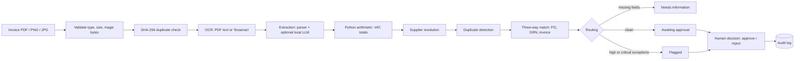

# BizPilot AI: Enterprise Invoice & Procurement Automation

An offline-capable finance operations platform. It ingests supplier invoices, extracts fields with OCR,
validates the arithmetic, matches each invoice against its purchase order and goods receipt, detects duplicates,
routes exceptions to people, and records every decision in an audit log.

**It never executes payments.** Approval records an authorization decision only.

Everything runs on free and open-source software: Python 3.13, FastAPI, Streamlit, SQLite (PostgreSQL-compatible
through SQLAlchemy), Tesseract OCR, PyMuPDF, Plotly, and optionally Ollama (Qwen 2.5 3B) and n8n Community Edition.

> **Status:** prototype for a portfolio and demonstration. Not production-ready. See [Implementation status](#implementation-status).

---

## Quick start (Windows PowerShell)

### 1. Install prerequisites
- **Python 3.13** from python.org. Tick "Add python.exe to PATH".
- **Tesseract OCR**: install the UB-Mannheim build from https://github.com/UB-Mannheim/tesseract/wiki
  (default path `C:\Program Files\Tesseract-OCR\tesseract.exe`).
- **Ollama** (optional, for the local LLM): https://ollama.com/download
- **Git**, and **Docker Desktop** if you want the containerized stack.

### 2. Set up the project
```powershell
git clone https://github.com/<your-user>/bizpilot-ai.git
cd bizpilot-ai
py -3.13 -m venv .venv
.\.venv\Scripts\Activate.ps1
```
If PowerShell blocks the activation script, run once:
`Set-ExecutionPolicy -Scope CurrentUser RemoteSigned`

```powershell
python -m pip install --upgrade pip
pip install -r requirements.txt
Copy-Item .env.example .env
```

Open `.env` and set `TESSERACT_CMD` to your Tesseract path if it is not on PATH. Change `DEMO_PASSWORD` before sharing the database.

### 3. Initialize, seed and test
```powershell
python scripts\init_db.py
python scripts\seed_demo.py
python -m pytest -q
```
Expected: `65 passed` with Tesseract installed. OCR-dependent tests may be skipped if Tesseract is unavailable.

### 4. Run the API and dashboard
Terminal 1:
```powershell
.\.venv\Scripts\Activate.ps1
uvicorn app.api.main:app --reload --port 8000
```
Terminal 2:
```powershell
.\.venv\Scripts\Activate.ps1
streamlit run dashboard\streamlit_app.py
```
- Dashboard: http://localhost:8501 (sign in as `fin.manager` / your `DEMO_PASSWORD`)
- API docs: http://localhost:8000/docs

### 5. Optional: local LLM
```powershell
ollama pull qwen2.5:3b
```
The LLM only fills missing extraction fields and rephrases answers. If Ollama is off or unreachable, BizPilot keeps working with deterministic parsing alone.

---

## Demo accounts

| Username | Role | Can do |
|---|---|---|
| `admin` | admin | Everything, including thresholds and demo data. Approves above threshold. |
| `fin.manager` | finance_manager | Approve, reject, resolve exceptions. Approves up to the threshold. |
| `ap.clerk` | ap_clerk | Upload, correct fields, request information. |
| `viewer` | viewer | Read-only. |

All use the `DEMO_PASSWORD` from `.env`.

---

## Docker (optional)

```powershell
docker compose up --build -d
docker compose exec api python scripts/init_db.py
docker compose exec api python scripts/seed_demo.py
docker compose exec ollama ollama pull qwen2.5:3b
```
Dashboard on :8501, API on :8000, n8n on :5678, Ollama on :11434.
SQLite is shared through the `./data` volume. Use PostgreSQL via `DATABASE_URL` for multi-writer deployments.

---

## Workflow



## Project structure

```
app/
  api/            FastAPI app, auth dependency, endpoints
  services/       Business logic (no HTTP or UI code)
    ocr.py          PDF text, scanned PDF rendering, Tesseract
    extraction.py   Line-anchored field parsing with confidence scores
    validation.py   Decimal arithmetic, VAT, consistency checks
    duplicates.py   Hash, invoice-number, fuzzy and amount/date checks
    matching.py     Three-way match and supplier resolution
    approvals.py    Permissions, thresholds, decisions, exception resolution
    invoices.py     Pipeline orchestration and serialization
    tools.py        17 agent tools, all read or write the real database
    agent.py        Deterministic intent routing and confirmation gate
    llm.py          Optional Ollama client (advisory only)
    analytics.py    KPIs, trends, performance, exception statistics
    seed.py         Demo data loader (runs the real pipeline)
  models.py       SQLAlchemy ORM
  schemas.py      Pydantic models for extraction and API bodies
  security.py     PBKDF2 password hashing, tokens, role matrix
dashboard/        Streamlit enterprise dashboard (8 sections)
data/samples/     Fictional suppliers, POs, GRNs and six sample invoices
n8n/              Importable workflow JSON (see docs/API.md)
tests/            65 automated tests
docs/             Architecture and API reference
scripts/          init_db.py and seed_demo.py
```

---

## Implementation status

**Implemented and covered by automated tests (65 tests, all passing):**
- Upload validation (extension, size, magic bytes), content-addressed storage, no public file serving
- OCR: native PDF text, scanned-PDF rendering with Tesseract, image OCR (tested against a real Tesseract install)
- Structured extraction with per-field confidence, missing-field reporting, and Pydantic validation
- Decimal arithmetic for lines, discounts, VAT and totals, with independent recomputation
- Duplicate detection at four levels; exact file duplicates are blocked, others are flagged for review
- Three-way matching: missing PO, invalid supplier, unordered items, price mismatch, quantity mismatch,
  overbilling, duplicate billing, missing goods receipt
- Human approval: role matrix, configurable threshold, rejection is terminal, high or critical exceptions block approval,
  exception resolution with notes, decision history with reviewer identity
- Audit log for logins, uploads, analyses, decisions, agent tool calls and agent errors
- Agent: 17 database tools, deterministic routing, `confirm <code>` gate for every write action, role checks enforced
- FastAPI: bearer-token auth with expiry, standard error shape, n8n webhook with event-id idempotency

**Verified manually in this build:**
- API served with uvicorn and exercised over HTTP
- All eight dashboard sections rendered through Streamlit's test harness with no exceptions
- Seed pipeline produces the expected status and discrepancy for each sample invoice

**Written but not verified in this build:**
- Docker images and Compose stack (no Docker in the build environment)
- Ollama extraction assistance (the code path is exercised only with the LLM disabled)
- Windows commands above (written for Windows; run on a clean machine before relying on them)
- n8n workflow JSON (valid JSON, not yet imported into a live n8n instance)

**Planned, not done:**
- Alembic migrations (tables are created idempotently today; add Alembic before the first schema change)
- PostgreSQL test run
- Dashboard calling the API instead of the service layer directly
- Rate limiting, HTTPS termination, account lockout, and secret rotation
- Email or Slack approval notifications
- Layout templates per supplier, to lift extraction beyond the sample invoice format

**Known limitations:**
- The parser is tuned to labelled invoices such as the samples. Free-form invoices from other suppliers will often need the LLM assist or a template.
- OCR accuracy depends on scan quality. Handwriting is not supported.
- SQLite is single-writer. Fine for a demo, not for concurrent production load.

## Testing

```powershell
python -m pytest -q
```
Tests use a temporary database and upload directory, with the LLM disabled and fast password hashing, so they never touch your real data.

## Licence and data

Sample invoices, suppliers and purchase orders are fictional. Do not commit real supplier or financial data.
