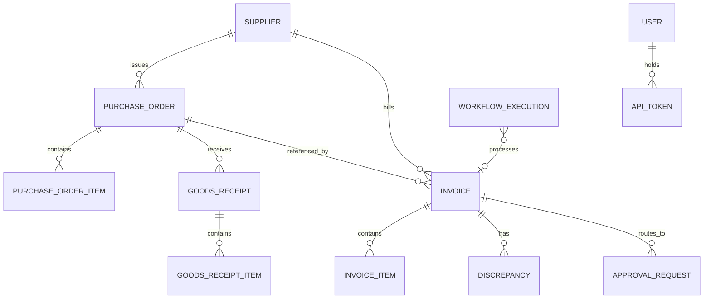
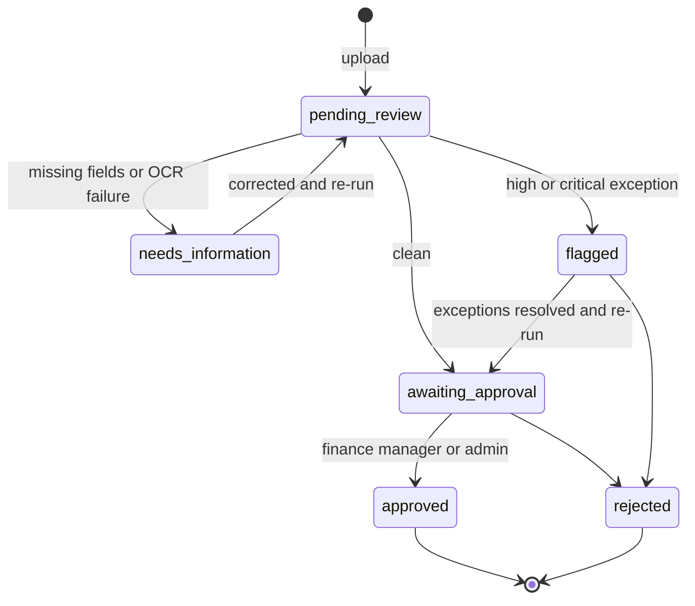

# Architecture

## Layers

| Layer | Location | Responsibility |
|---|---|---|
| Presentation | `dashboard/`, `app/api/` | Streamlit UI and FastAPI handlers. Translate input and output only. |
| Services | `app/services/` | All business rules. Shared by the API, the dashboard and the agent. |
| Persistence | `app/models.py`, `app/db.py` | SQLAlchemy ORM. SQLite by default, any SQLAlchemy URL. |
| Integrations | `app/services/llm.py`, n8n webhook | Optional and advisory. Failure never blocks the core pipeline. |

Keeping rules in services means a change to the approval policy applies identically to the API, the dashboard and the agent.

## Data model

Audit events live in `audit_logs` and are append-only by convention: the application never updates or deletes them.

## Invoice state machine

No transition leads to `approved` without a human actor. The router can return `awaiting_approval` at best.

## Key design decisions

1. **Deterministic first.** Totals, matching, duplicate checks and routing are plain Python. The LLM proposes values only for missing fields, marks them at 0.5 confidence, and they must pass validation.
2. **Agent cannot invent data.** Intents are routed by pattern matching. Tools query the database. The LLM may only rephrase tool output.
3. **Write actions are gated.** The agent returns a one-time code and executes only on `confirm <code>`, under the same role check as the API.
4. **Exact duplicates are blocked; similar ones are flagged.** Only identical bytes are refused automatically. Everything else goes to a human, to avoid rejecting legitimate invoices.
5. **Resolved exceptions persist.** A reviewer's resolution carries forward when an invoice is re-analysed, unless the underlying discrepancy changes.
6. **Idempotent entry points.** Upload is keyed on SHA-256. Webhooks are keyed on `X-Event-Id`. Decisions are guarded by state transitions.
7. **Secrets and files stay private.** Passwords use PBKDF2-SHA256 from the standard library. Tokens are stored as hashes. Uploads are stored under their hash and never served.

## Security controls

| Control | Implementation |
|---|---|
| Password storage | PBKDF2-SHA256, 310,000 iterations, per-user salt |
| Sessions | Random 256-bit bearer tokens, hashed at rest, 12-hour expiry |
| Authorization | Role matrix in `app/security.py`, enforced in services, so the API, dashboard and agent share one policy |
| Upload safety | Extension allow-list, size limit, magic-byte check |
| Webhook | Shared secret compared in constant time |
| Error handling | Stack traces logged server-side only. Clients receive `{"error": {"code", "message"}}`. |
| Audit | Logins, uploads, analyses, decisions, exception resolutions, threshold changes, agent calls and errors |

## Planned production hardening
Rate limiting and lockout on `/api/auth/login`, HTTPS termination in front of the API, secrets from a vault, PostgreSQL with row-level backups, Alembic migrations, and an API-only dashboard client.
